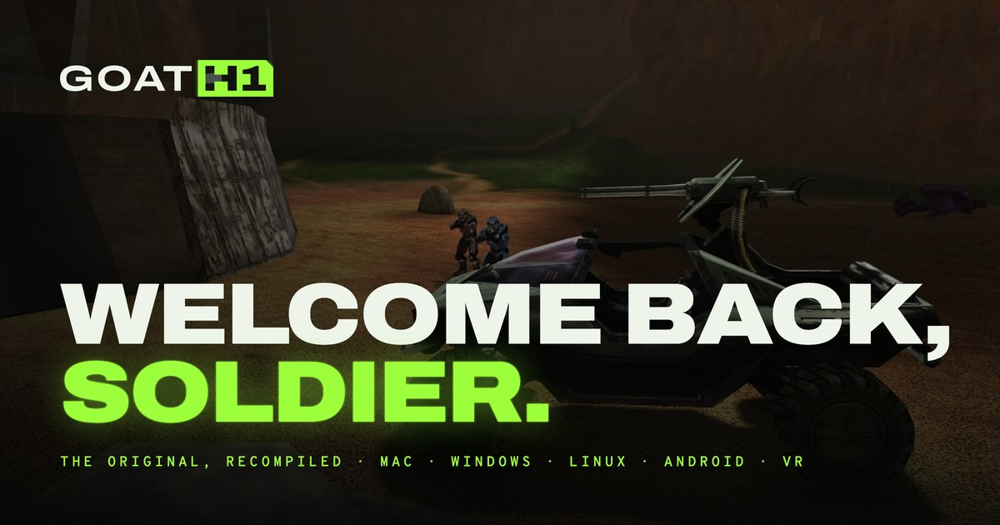

<p align="center">
  <a href="https://goath1.com"></a>
</p>

<h3 align="center">Halo: Combat Evolved, recompiled for Mac, Windows, Linux, Android and VR.</h3>

<p align="center">
  The original game, built natively from its own code. It feels sharper at
  60 or 120 ticks, looks the way you remember, and brings the campaign
  online with your friends.
</p>

<p align="center">
  <a href="https://github.com/OpenH1/goath1/releases/latest"></a>
  <a href="https://github.com/OpenH1/goath1/actions/workflows/build.yml"></a>
  <a href="https://discord.gg/MJa327PSWt"></a>
  <a href="LICENSE"></a>
</p>

<p align="center">
  <a href="#download"><b>Download</b></a> ·
  <a href="https://goath1.com">goath1.com</a> ·
  <a href="https://discord.gg/MJa327PSWt">Discord</a> ·
  <a href="#game-data">Bring your own game</a> ·
  <a href="#contributing">Contributing</a>
</p>

GOAT H1 is the 2001 Xbox game's own code, compiled natively for each
platform. Not a remake, not emulation: the same game, now at 60 or 120
ticks, with new renderers, a new menu and lobby, online co-op, VR, and the
maps the community has made since.

## Features

**60 and 120 tick.** What you feel in your hands (your movement, aim,
shots, projectiles and thrown items) runs at 60 ticks a second by default,
or 120. ORIGINAL keeps the 2001 game's 30.

**Play it anywhere**

- **Native on every platform:** a Mac app for Apple silicon (signed,
  notarized, updates itself), Windows, Linux and the Steam Deck, and
  Android.
- **New renderers:** Metal on the Mac, Vulkan everywhere else. SMAA,
  per-pixel dynamic lights, HDR, and frames drawn between ticks at your
  display's rate (4K, 120 Hz and up). One switch between Classic and
  Enhanced.
- **VR** on the Steam Frame and OpenXR headsets: reload by hand, draw from
  holsters, raise the scope to your eye.

**Play it together**

- **Online co-op campaign:** one CO-OP screen to host or join. Friends see
  your game and join it; the host can change the level or bring a player
  over.
- **Split screen** for up to 4 players on each machine, offline and online.
  Every player has their own profile: controls, button prompts, field of
  view, aim style.
- **A new lobby:** map picture, player cards, your Spartans lined up, text
  and voice chat, friend invites, and ADD PLAYER for another controller.
- **Up to 128 players** online and on the LAN. Server browser and invite
  links; no servers to set up. PRO 2V2 matchmaking.
- **Spartan link:** live feeds of your teammates' views in the HUD.
- **Plays with OpenCE players:** host a Legacy game, or let them into yours.

**Play it your way**

- **Modern Aim** for controllers, beside Classic, plus gyro and flick stick.
- **Hit sounds**, if you want them (a host can switch them off).
- **Ride on vehicles:** stand on a moving Warthog and stay on it (a host
  option and gametype rule).
- **Custom Edition and MCC maps** from the game's own menus, shared with
  players who join ([docs/mcc_maps.md](docs/mcc_maps.md)). Texture, sound
  and model mods too ([docs/mods.md](docs/mods.md)).

| | Original | GOAT H1 |
| --- | --- | --- |
| **Dynamic lights**<br><sub>Rat Race, a frag grenade</sub> |  |  |
| **Anti-aliasing**<br><sub>Blood Gulch, enlarged 4×</sub> |  |  |
| **Plasma glow**<br><sub>Blood Gulch, a charged plasma pistol</sub> |  |  |

<sub>Real captures, the same moment twice. [goath1.com](https://goath1.com) has them side by side, with clips.</sub>

## Download

Builds of the latest release:

| Platform | Download |
| --- | --- |
| macOS (Apple silicon, macOS 14.4 or later) | [OpenH1.dmg](https://github.com/OpenH1/goath1/releases/latest/download/OpenH1.dmg) |
| Windows 10 1903 or later | [OpenH1-Windows.zip](https://github.com/OpenH1/goath1/releases/latest/download/OpenH1-Windows.zip) |
| Linux x86-64 and the Steam Deck | [OpenH1-Linux.zip](https://github.com/OpenH1/goath1/releases/latest/download/OpenH1-Linux.zip) |
| Linux arm64 | [OpenH1-Linux-ARM64.zip](https://github.com/OpenH1/goath1/releases/latest/download/OpenH1-Linux-ARM64.zip) |
| Linux x86-64 VR | [OpenH1-Linux-VR.zip](https://github.com/OpenH1/goath1/releases/latest/download/OpenH1-Linux-VR.zip) |
| Steam Frame VR ([install](port/linux/frame/README.md#install-or-update)) | [OpenH1-Steam-Frame.zip](https://github.com/OpenH1/goath1/releases/latest/download/OpenH1-Steam-Frame.zip) |
| Android (64-bit, Android 9 or later, Vulkan 1.3) | [OpenH1-Android.apk](https://github.com/OpenH1/goath1/releases/latest/download/OpenH1-Android.apk) |

- **macOS:** open the `.dmg` and drag GOAT H1 to Applications.
- **Windows:** unzip and start `halo.exe`. Windows warns about any unsigned
  app: choose **More info**, then **Run anyway**. Or install it with
  [Scoop](port/windows/README.md#install-with-scoop).
- **Linux and the Steam Deck:** unzip and open `install.sh` (on a Steam
  Deck, in Desktop Mode). It adds the game to the application menu and, on
  a Steam Deck, to Game Mode. Needs Vulkan 1.3.
- **Android:** open the APK on the phone to install it
  ([port/android/README.md](port/android/README.md)).

The builds update themselves (a Scoop install updates with Scoop). Debug builds, older releases and signed
checksums are on the [Releases](https://github.com/OpenH1/goath1/releases)
page ([docs/releasing.md](docs/releasing.md)).

<a name="game-data"></a>
## Bring your own game

GOAT H1 includes no game data. You need your own copy of Halo: Combat
Evolved for the original Xbox, as a disc image (`.xiso` or `.iso`) made
from a disc you own. At the first start, the game asks for the image and
extracts its maps. Any region works.
[goath1.com/maps](https://goath1.com/maps) says how to make the image and
how to add Custom Edition and MCC maps.

## Learn more

- [port/linux/README.md](port/linux/README.md): controls, settings,
  multiplayer and VR (almost the same on every platform).
- Each platform's own notes: [macOS](port/macos/README.md),
  [Windows](port/windows/README.md), [Android](port/android/README.md),
  [iOS](port/ios/README.md) (built from source, not released yet).
- [port/linux/NETCODE.md](port/linux/NETCODE.md): the netcode;
  [docs/dedicated_server.md](docs/dedicated_server.md): dedicated servers.

## Build the game

You need Python and [ninja](https://ninja-build.org/), plus your platform's
tools (in its README). Then, in the repository's folder:

```sh
python configure.py
ninja
```

[docs/building.md](docs/building.md) has the targets, the options, the
compiler, the optimization profiles and the tests.

## Contributing

Pull requests are welcome, from small fixes to whole renderer features. We
review them promptly and merge what is ready.

1. Fork the repository and branch from `master`.
2. Read [AGENTS.md](AGENTS.md): the layout, the conventions (the game's
   sources are C89), the tests, and what must stay deterministic.
3. Open a pull request, and say what you tested and what still needs a
   device to check. GitHub Actions builds and tests it.

Fixes waiting in OpenCE are welcome here too: we bring them in with their
authorship kept. A change to what the game sends over the network must
keep it playable with OpenCE ([NETCODE.md](port/linux/NETCODE.md)).

Report problems on the [issue tracker](https://github.com/OpenH1/goath1/issues)
with the build number (Settings > Profile > About) and `debug.txt`. For
help, ask on the [Discord](https://discord.gg/MJa327PSWt).

## Built on

GOAT H1 stands on the work of many people, and we are grateful to them:

- [OpenCE](https://github.com/OpenCommunityEdition/OpenCE), the community's
  port, which GOAT H1 started from and still merges. Its netcode is why the
  two play together.
- [bnunu/halo-1](https://github.com/bnunu/halo-1) and
  [punpckhdq/halo](https://github.com/punpckhdq/halo), the decompilation
  OpenCE starts from, of the Xbox build 2342 (`cachebeta.exe`, SHA-256
  `4cc87b45f721270392a96f1674ed2b5cd4a7bb4355faeab4531d1cf1884d9520`).
- ChupathingyCE's reader for Custom Edition's installer, Viktor Chlumsky's
  msdfgen for the high-res text, and the other third-party code, fonts and
  art in `port/third_party` and `port/assets`, each under its own license.

## License

GOAT H1 is free software under the GNU Affero General Public License,
version 3 or later (`AGPL-3.0-or-later`), with no warranty; the text is in
[LICENSE](LICENSE). If you run a changed version that others play over a
network, the AGPL asks you to offer them its source.

The AGPL applies from the commit that made the change (taken with the merge
of OpenCE, which made it) and to releases built from then on. Earlier
commits and releases stay under [CC0 1.0](LICENSES/CC0-1.0.txt).
punpckhdq/halo is under the AGPL 3.0 from 17 October 2026 and CC0 1.0
before; bnunu/halo-1 is under CC0 1.0. Changes taken from GPL 3.0 projects
keep that license.

GOAT H1 is an unofficial fan project, not endorsed by or affiliated with
Microsoft, Xbox Game Studios, Halo Studios or Bungie. Halo is a trademark
of Microsoft Corporation, and the license gives no rights in Halo or its
maps.
